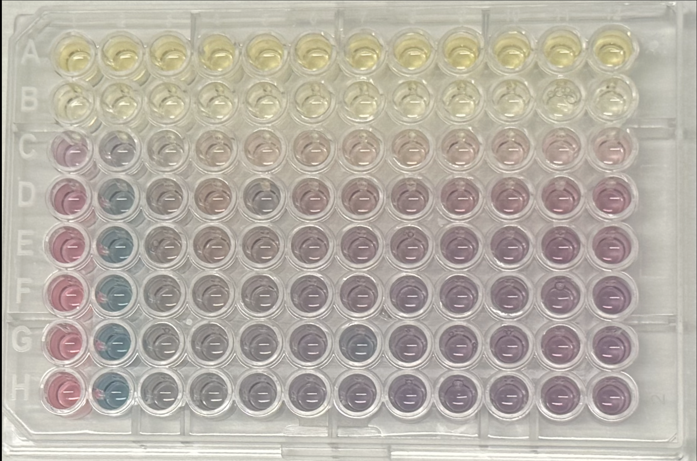

<p align="center">  </p>

# LLM for High-throughput Nanoparticle Synthesis
Anonymous github page for LLM Synthesis project

# Code and Data for Reproducing Figures 1 and 2

This repository contains the dataset and analysis notebook associated with the anonymous submission.

## Contents

* `plate_spectra.xlsx` — UV–vis absorbance spectra collected from the high-throughput experiments. The workbook contains one sheet for each experimental run.
* `Notebook_LLMSynthesis.ipynb` — Jupyter notebook used to process the spectral data and generate Figures 1 and 2.

## Figure 1

The notebook identifies the peak wavelength, \(\lambda_{\max}\), for each well within the specified spectral window and visualizes the results as plate heatmaps.

All experimental runs are plotted using a shared color scale so that the same color corresponds to the same peak wavelength across runs.

## Figure 2

The notebook provides a more detailed analysis of a representative experimental run, including:

* peak wavelength calculated over the full spectral window;
* peak wavelength restricted to the longitudinal plasmon region;
* the ratio of longitudinal to transverse peak absorbance; and
* representative UV–vis spectra illustrating the underlying spectral behavior.

The analysis parameters and spectral windows used to generate the panels are specified directly in the notebook.

## Running the Analysis

Place `plate_spectra.xlsx` and `Notebook_LLMSynthesis.ipynb` in the same directory and run the notebook from beginning to end.

The analysis requires Python and the following packages:

```text
numpy
pandas
matplotlib
openpyxl
jupyter
```

These can be installed using:

```bash
pip install numpy pandas matplotlib openpyxl jupyter
```

The notebook generates the figures as both PNG and PDF files.

## Reproducibility

All quantities shown in Figures are calculated directly from the provided spectral dataset. No additional experimental data are required to reproduce these figures.


## Citation

If you are using this code/data/result, please reference our paper:
```
@article{patel2026multimodal,
  title={Multimodal LLM-Assisted Diagnosis of Cryptic Failure Modes in High-Throughput Experimentation: A Case Study in Gold Nanorod Synthesis},
  author={Patel, Riya and Briceno, Gabriela and Aghazadeh, Amirali and Jamali, Vida},
  year={2026}
 journal={NeurIPS, AI for Accelarated Materials Design (AI4Mat) Workshop
}
```
```
@article{
doi:10.26434/chemrxiv.15009205/v1,
author = {Riya Patel  and Gabriela Briceno  and Amirali Aghazadeh  and Vida Jamali },
title = {Multimodal LLM-Assisted Diagnosis of Cryptic Failure Modes in High-Throughput Experimentation: A Case Study in Gold Nanorod Synthesis},
journal = {ChemRxiv},
volume = {2026},
number = {0921},
pages = {},
year = {2026},
doi = {10.26434/chemrxiv.15009205/v1}
}
```    
